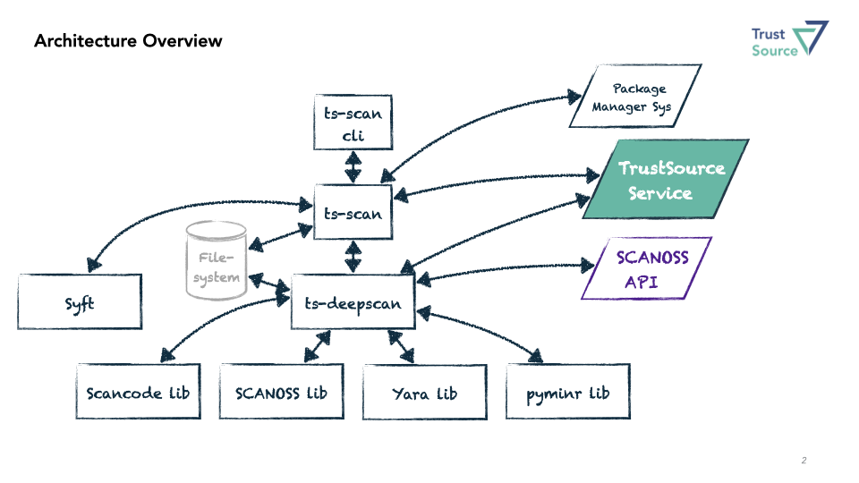

# Architecture Overview

***ts-scan*** is a commandline utility developed in python to simplify all code compliance related tasks and unify the handling across different environments. For DevOps this means, you may use the same command set across different environments, whether you are building Java, Go or Python.

With ***ts-scan*** you will be able to perform all sorts of scans. Whether you want to compose a Software Bill of Materials (SBOM), check a repository for hidden license information, check for malware or just scan a Docker file. All can be done using the same tool. 

## System Components

To achieve this, we assembled a combination of best of breed solutions. This comprises

* **Syft**: supporting the **decomposition of Docker images** and derivation of SBOMs form an image. What we like about [Syft](https://github.com/anchore/syft) is its ability to assess images as well as Docker files.
* **Scancode**: extends deepscan capabilities to assess non-text files in the search for hidden license information and **copright texts**. [NexB](https://github.com/aboutcode-org/scancode-toolkit), the authors of Scancode, maintain a huge library of keys, patterns and license information. 
* **SCANOSS**: The fingerprinting mechanism by [SCANOSS](https://scanoss.com) is unique as well as their data archive. Sitting on a huge database of internets history, it is possible to identify already seen **code snippets** and derive potential 3rd party copyrights. Especially in the era of AI-driven development code ownership becomes a topic of growing concern. 
* **PyMinr**: Is our [Python wrapper](https://github.com/trustsource/pyminr) around the *[minr](https://github.com/scanoss/minr)* implementation, a search algorithm to identify **encryption algorithms** within the code. This is important for import and export controls but also to fortify your solutions against hte upcoming Quatum computing era.
* **Yara**: is the quasi standard for **malware** assessment. Whether you are looking into binaries or are searching for specific text combinations, [yara](https://github.com/VirusTotal/yara) expressions will be able to identify it, if it exists. However, you also may use yara to improve your findings. Learn more in this blogpost.

Besides these cool tools we also provide a few capabilities to the party:

* **ts-scan**: Is not only the orchestrator but has the ability to identify the build environment, execute the corresponding package manager and pull all transitive packages, if required. These packages then will assessed using 
* **ts-deepscan**: The repo/file scanner, we provided. [ts-deepcan](https://github.com/trustsource/ts-deepscan) combines all the file based scanning capabilities described above. Its origin is license identification. **DeepScan** has the ability to discover known text fragments, allowing to identify licenses, even when they are slightly transformed or changed using similarity search.  

 [ts-scan](https://github.com/trustsource/ts-scan) can write its results either into a local file using the *TrustSource*, *SPDX* or *CycloneDX* formats or transfer the results to the [**TrustSource** platform](https://app.trustsource.io/) for further treatment using the [UPLOAD](index) verb..

## Package Managers

For the sake of simplicity we do not include all package managers with the delivery. Typically a use case is bound to one or two environments at maximum. Thus, it would be overdosed to always supply all package managers. We designed a plugin architecture allowing to add specific package management systems. **ts-scan** provides the connectivity to the services, but you will have to provide / install them separately. 

#### Why does *ts-scan* require the eco-systems being installed?

Because we are interested to ***derive all transitive dependencies*** as they will end up in the solution you are really delivering. This can only be determined, when you are building the software. To build the software, it is not enough to understand the package list, you will have to look inside the packages. All other  approaches - e.g. file-based scanning only - will not deliver the truth. 

Please see the Setup for inofrmation on how to install the corresponding ecosystems. 

#### Is there a preconfigured image with all eco-systems setup?

We currently do not provide such an image. It would be quiet large and we do not want to maintain it. However, we do provide a [Docker image](https://hub.docker.com/r/trustsource/ts-scan) for operating **ts-scan**, but without any added environments. This would be a good starting point, if you plan to  there are environment specific images available at DockerHub. Alternatively you might want to use the preconfigured image from [OSS Review Toolkit](https://oss-review-toolkit.org/) (ORT), which does scanning the same way. ORT has a TrustSource format reporter included and thus, these findings can be uploaded to [TrustSource](https://app.trustsource.io) as well. 

## Configuration Layers

*ts-scan* separates two kinds of settings:

| Layer | Location | Contents | Decided by |
|---|---|---|---|
| Tool settings | command line, environment, user settings file `~/.ts-scan/config` (profiles) | `api_key`, `base_url`; options that run programs or write files (`<pm>_executable`, `<pm>_forward`, `output_path`, `node_enableLifecycleScripts`); values with environment references (`${VAR}`), e.g. an index URL with credentials | whoever runs *ts-scan* (developer, CI) |
| Project settings | `tsproject.toml` in the scanned directory | `project_name`, scan options, e.g. `pypi_indexUrl` without credentials | the scanned repository |

Tool settings are resolved once at start-up and passed to the API client, which normalizes the base URL to end with the API version (`/v2`). Project settings are merged in afterwards through a single loader (`_load_project_config`) that drops everything a scanned repository must not decide, with a warning. Precedence: command line > environment > project settings > user settings file.

## Architecture Decision Records

### ADR-001: API endpoint and key are tool settings only (2026-11-02, v2.0.0)

**Context:** project settings from the scanned directory were merged into the option defaults without restriction. A `tsproject.toml` in a foreign repository could set `base_url` and thereby send the API key of the user or CI pipeline to an endpoint of its choice.

**Decision:** `api_key` and `base_url` are taken from the command line, the environment or the user settings file only. The project settings loader ignores them with a warning. `ts-scan init` no longer accepts them; the new `ts-scan configure` command writes them to a profile of the user settings file. The base URL carries the API version, API paths do not.

**Consequences:** breaking change for projects that kept the key or a custom endpoint in `tsproject.toml`; they have to move it to the user settings file, the environment or the command line. A scanned repository can still choose the project name.

### ADR-002: Project settings cannot run programs, write files or read the environment (2026-11-06, v2.0.0)

**Context:** `ts-scan scan` did not read the `tsproject.toml` of the scanned directory at all, because the loader looked for a `path` argument and `scan` takes `sources`. Fixing that, to allow a company package index per project (`pypi_indexUrl`, #40), would have let a foreign repository set `node_executable` or `<pm>_forward` and thereby run a program of its choice, overwrite files through `output_path`, enable npm lifecycle scripts, or send environment variables (e.g. CI secrets) to an index of its choice through `${VAR}` references, which the PyPI scanner expands in index URLs.

**Decision:** the project settings loader drops `<pm>_executable`, `<pm>_forward`, `output_path` and `node_enableLifecycleScripts`, and every value that contains `$`, with a warning. They are tool settings like the API key (ADR-001). An index URL without credentials may stay in the project settings; credentials are provided as a tool setting, e.g. `TS_SCAN_PYPI_INDEXURL` from a CI secret, or through pip's `~/.netrc` or keyring.

**Consequences:** projects that set executables, forwarded parameters or an output file in `tsproject.toml` have to move them to the user settings file, the environment or the command line. A scanned Python project still runs its build backend while pip prepares its metadata; scanning untrusted Python projects requires an isolated environment such as the ts-scan container.

## Further development

It is possible - and highly desired - to extend **ts-scan** with additional package management systems. In the [developer's guide](/ts-scan/guidelines) we describe how simple it is, to extend it using the plugin mechanism of Python.

To add extensions on the file assessment, we recommend to extend ts-deepscan, which is living in a separate [repository](https://github.com/trustsource/ts-deepscan).

To learn more about our plans, see the [roadmap](/ts-scan/roadmap.md).
